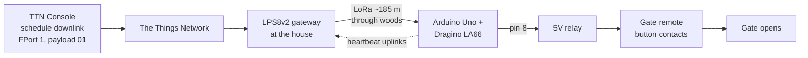
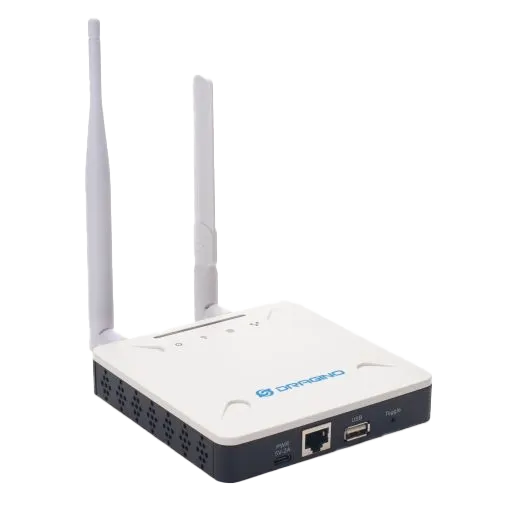
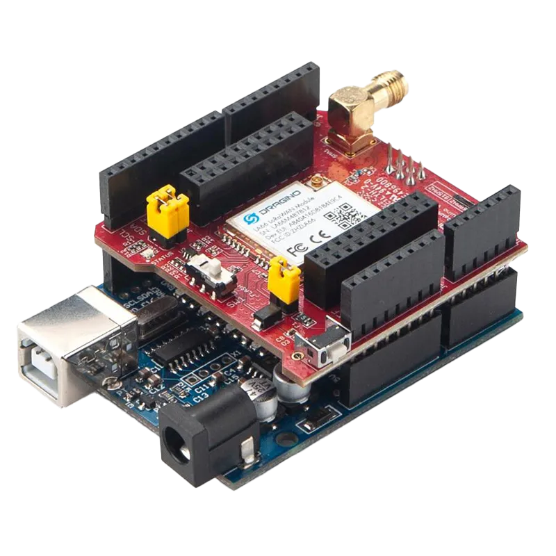
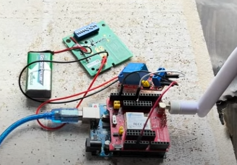

# LoRaWAN Gate Opener

A long-range, low-power remote gate opener built on LoRaWAN. A Dragino LA66 shield on an Arduino Uno sits at a farm gate about 185 m from the house, through dense woods. When it receives a command over The Things Network (TTN), it triggers the gate's existing remote. No new wiring, no Wi-Fi at the gate.

Final project for **CS 4491 (Introduction to AI-Driven Resource Allocation / Antennas for Network Softwarization)** at Kennesaw State University, Spring 2025, by **Daniel Painter** and **Jaden Nguyen**.

[](https://youtu.be/4RQGOcqQTLM)

▶ **[Watch the demo](https://youtu.be/4RQGOcqQTLM)** · 📄 **[Read the full report (PDF)](final-project/docs/LoRaWAN_Gate_Opener.pdf)**

---

## The problem

The gate at the end of our farm's driveway used to be opened from the house over a landline. Once the landline went away, so did that option, which meant a quarter-mile walk or drive every time someone needed to be let in. Running new cable through the woods would be expensive and labor-intensive, and Wi-Fi doesn't reach that far.

LoRaWAN is built for exactly this: small messages, long range, low power. Most LoRaWAN projects use it for sensor data. This one uses it to control a gate remote.

## How it works



1. The Uno resets the LA66, configures its OTAA keys, and joins TTN.
2. After joining, it sends **heartbeat uplinks** on a timer. TTN can only deliver a queued downlink in the receive window that follows an uplink, so the heartbeat is what gives the network a chance to reach the device.
3. To open the gate, a downlink with payload `01` on FPort 1 is scheduled from the TTN console.
4. When the LA66 reports that downlink, the Uno drives pin 8 HIGH for one second. That closes a relay soldered across the button of an old gate remote, which "presses" the button.

## Hardware

| Part | Role |
|---|---|
| Arduino Uno | Runs the firmware |
| Dragino LA66 LoRaWAN shield | LoRaWAN radio, controlled over AT commands |
| Dragino LPS8v2 LoRaWAN gateway | At the house; forwards traffic to TTN |
| DC 5V 1-channel relay module | Closes the remote's button circuit |
| LINEAR Multicode 1-button gate remote (308911) | Opened up, button desoldered, two wires run to the relay |

<p align="center">
  
  
  
</p>

### Wiring

| From | To |
|---|---|
| Relay VCC / GND | Uno 5V / GND |
| Relay IN | Uno D8 |
| Relay COM / NO | The two wires soldered in place of the remote's button |
| LA66 shield UART | Uno D10 (RX) / D11 (TX) via `SoftwareSerial` |

## Firmware setup

The sketch is in [`final-project/firmware/gate_opener/`](final-project/firmware/gate_opener/).

1. Register the LA66 as an end device in your TTN application (OTAA). Note the DevEUI, AppEUI (JoinEUI) and AppKey.
2. Copy `secrets.example.h` to `secrets.h` in the same folder and fill in those three values. `secrets.h` is gitignored, so your keys stay off GitHub.
3. Open `gate_opener.ino` in the Arduino IDE, select **Arduino Uno**, and upload.
4. Open the Serial Monitor at 9600 baud. You should see the module reset, then `JOINED` once it's on the network.
5. In the TTN console, schedule a downlink on **FPort 1** with payload **`01`**. The relay clicks the next time the device checks in.

Timing is set at the top of the sketch:

| Constant | Purpose |
|---|---|
| `HEARTBEAT_INTERVAL_MS` | How often an uplink is sent. This also sets the worst-case delay before a command arrives. |
| `POLL_INTERVAL_MS` | How often the Uno asks the LA66 for buffered downlinks (`AT+RECVB?`) |
| `RELAY_PIN` | Output pin for the relay (default 8) |

## Repository layout

```
final-project/
  firmware/gate_opener/   Arduino sketch + secrets.example.h
  docs/                   Full project report (PDF)
  images/                 Photos and diagrams used in this README
coursework/               Other CS 4491 LoRa work (see coursework/README.md)
LICENSE                   MIT
```

## Credits

- **Daniel Painter** and **Jaden Nguyen**: design, build, testing and report
- **Dr. Ahyoung Lee**: course instructor
- The firmware started from Dragino's `Join-TTN-network` example for the LA66 shield

## License

The code in this repository is released under the [MIT License](LICENSE).
